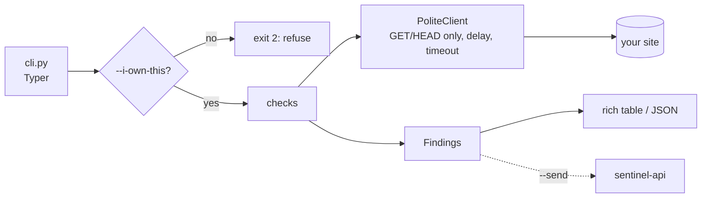

# sentinel-scanner

Defensive security scanner and log analyzer for the **Sentinel** platform
([sentinel-api](https://github.com/MundatiC/sentinel-api) · [sentinel-dashboard](https://github.com/MundatiC/sentinel-dashboard)).

> Status: **step 4 of 5** (web checks, dependency scanning, log analysis, API ingestion). The post-mortem generator arrives in the last step. Plan: [docs/PLAN.md](docs/PLAN.md).

## Responsible use

This tool is **defensive only**. It scans systems **you own or have written permission to test**, and it refuses to run
a web scan without `--i-own-this`. It is read-only (GET/HEAD), sends no payloads, contains no exploit code and
collects no credentials.

## Quick start

Requires Python 3.11+.

```bash
python -m venv .venv && . .venv/bin/activate
pip install -e ".[dev]"
sentinel-scan --help
sentinel-scan web https://your-own-site.example --i-own-this
pytest
```

## `sentinel-scan web`

```bash
sentinel-scan web https://your-own-site.example --i-own-this
sentinel-scan web https://your-own-site.example --i-own-this --checks headers,tls --format json
```

| Check     | What it looks at                                                                                      |
| --------- | ----------------------------------------------------------------------------------------------------- |
| `headers` | CSP (and unsafe sources), HSTS, nosniff, clickjacking protection, Referrer/Permissions-Policy, `Server`/`X-Powered-By` leaks |
| `cookies` | `Secure`, `HttpOnly`, `SameSite` on every `Set-Cookie` (names only, values are never read or stored)   |
| `tls`     | Certificate validity/hostname/expiry, deprecated protocols (1.0/1.1), weak ciphers, HTTP to HTTPS redirect |
| `files`   | 14 well-known sensitive paths (`.env`, `.git/HEAD`, SQL dumps, backups...), confirmed by content signature |

Exit codes: `0` ok, `1` findings at or above `--fail-on` (default `HIGH`, handy in CI), `2` refused or bad usage, `3` target unreachable.

### Why this is safe to run

- **Read-only:** GET and HEAD only, one request at a time, 0.5 s apart, honest `User-Agent`. No payloads are ever sent.
- **No secrets copied:** the exposed-files check reads at most 1 KB and keeps only status, size and a SHA-256 fingerprint, never content. Cookie values are discarded at parse time.
- **A hit needs a signature,** not just `200 OK`, so sites that answer 200 for every path do not produce false positives.
- **Output is data, not markup:** text that came from the target cannot inject terminal formatting.

## `sentinel-scan deps`

```bash
sentinel-scan deps ./my-project                 # finds requirements.txt, package-lock.json, poetry.lock
sentinel-scan deps ./package-lock.json --format json --fail-on CRITICAL
```

Reads exact versions from the lockfile, asks the [OSV](https://osv.dev) database (`/v1/querybatch`, then one lookup per
unique vulnerability), and reports each vulnerable package with severity and the fixed version when one exists.

- **Privacy:** only package *names and versions* are sent to `api.osv.dev`; no code, paths or project names.
- **Only exact pins can be checked.** `requests>=2` does not say which version is installed, so unpinned lines are
  listed as *skipped* instead of silently ignored. Use a lockfile for full coverage.
- **Severity** comes from the advisory's own rating when present, otherwise it is computed from the CVSS v3 vector;
  if neither exists it is `MEDIUM` and marked `severityUnknown`.
- Vulnerability ids returned by the network are validated before being used in a URL.

## `sentinel-scan logs`

```bash
sentinel-scan logs /var/log/nginx/access.log --type nginx
sentinel-scan logs /var/log/auth.log --type auth --year 2026 --threshold 5 --window 60
sentinel-scan logs access.log --type nginx --send --source web-1     # let Sentinel raise the alerts
```

| Detector      | Logic                                                                                              |
| ------------- | -------------------------------------------------------------------------------------------------- |
| Brute force   | at least `--threshold` failed logins from one IP within any `--window` seconds (sshd `Failed password`, or web `401`). Same rule as the API's default, so you can compare. |
| Injection     | SQL injection, XSS, path traversal and command-chaining patterns in the URL-decoded (twice) request target |

- **Detection only.** Patterns are matched against log text; nothing is replayed, sent to the site, or executed.
  They are heuristics for spotting probes, not a filter: obfuscated payloads can slip through.
- Logs are untrusted: unparsable lines are counted and skipped, long lines are cut, IPs are validated, and attacker-controlled text is shown as plain text.
- Syslog timestamps have no year or timezone: `--year` sets the year (December lines read in January are handled) and
  zone-less times are treated as UTC.
- Exit codes: `0` nothing found, `1` detections, `4` events could not be sent.

## Sending results to sentinel-api (`--send`)

`web`, `deps` and `logs` accept `--send`. Configure with environment variables (never CLI flags: those end up in shell history and `ps`):

```bash
export SENTINEL_API_URL=http://localhost:4000
export SENTINEL_API_KEY=snt_...        # create it in sentinel-api: POST /api-keys (scopes: events:write, scans:write, incidents:read)
```

- `web`/`deps` send one scan (critical findings also become events); `logs` sends only the **detected** events
  (including the request path of injection attempts, so avoid it on logs whose URLs contain secrets).
- `--send` is validated **before** any work starts, results are printed **before** they are uploaded, and `--format json`
  keeps stdout pure JSON (status messages go to stderr).
- The API URL must be `https://`, except for localhost, private networks and single-label names like the compose service `api`,
  so the API key is never sent in clear text across the internet.
- Exit code `4` means the upload failed (the results were still printed).

## Architecture



## Screenshots

_Added with the final step._
