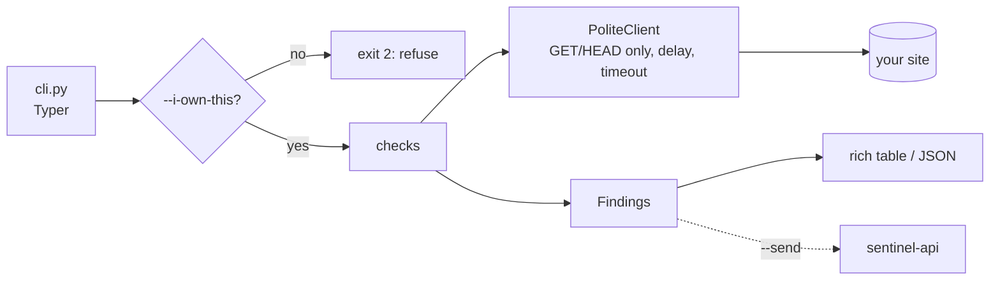

# sentinel-scanner

Defensive security scanner and log analyzer for the **Sentinel** platform
([sentinel-api](https://github.com/MundatiC/sentinel-api) · [sentinel-dashboard](https://github.com/MundatiC/sentinel-dashboard)).

> Status: **step 1 of 5** (scaffold + ownership guard). Checks arrive in the next steps. Plan: [docs/PLAN.md](docs/PLAN.md).

## Responsible use

This tool is **defensive only**. It scans systems **you own or have written permission to test**, and it refuses to run
a web scan without `--i-own-this`. It is read-only (GET/HEAD), sends no payloads, contains no exploit code and
collects no credentials.

## Quick start

Requires Python 3.11+.

```bash
python -m venv .venv && . .venv/bin/activate
pip install -e ".[dev]"
sentinel-scan --help
sentinel-scan web https://your-own-site.example --i-own-this
pytest
```

## Architecture



## Screenshots

_Added with the final step._
