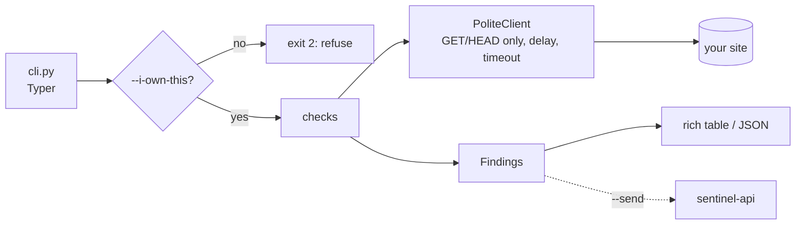

# sentinel-scanner

Defensive security scanner and log analyzer for the **Sentinel** platform
([sentinel-api](https://github.com/MundatiC/sentinel-api) · [sentinel-dashboard](https://github.com/MundatiC/sentinel-dashboard)).

> Status: **step 2 of 5** (web checks). Dependency scanning, log analysis and post-mortems arrive in the next steps. Plan: [docs/PLAN.md](docs/PLAN.md).

## Responsible use

This tool is **defensive only**. It scans systems **you own or have written permission to test**, and it refuses to run
a web scan without `--i-own-this`. It is read-only (GET/HEAD), sends no payloads, contains no exploit code and
collects no credentials.

## Quick start

Requires Python 3.11+.

```bash
python -m venv .venv && . .venv/bin/activate
pip install -e ".[dev]"
sentinel-scan --help
sentinel-scan web https://your-own-site.example --i-own-this
pytest
```

## `sentinel-scan web`

```bash
sentinel-scan web https://your-own-site.example --i-own-this
sentinel-scan web https://your-own-site.example --i-own-this --checks headers,tls --format json
```

| Check     | What it looks at                                                                                      |
| --------- | ----------------------------------------------------------------------------------------------------- |
| `headers` | CSP (and unsafe sources), HSTS, nosniff, clickjacking protection, Referrer/Permissions-Policy, `Server`/`X-Powered-By` leaks |
| `cookies` | `Secure`, `HttpOnly`, `SameSite` on every `Set-Cookie` (names only, values are never read or stored)   |
| `tls`     | Certificate validity/hostname/expiry, deprecated protocols (1.0/1.1), weak ciphers, HTTP to HTTPS redirect |
| `files`   | 14 well-known sensitive paths (`.env`, `.git/HEAD`, SQL dumps, backups...), confirmed by content signature |

Exit codes: `0` ok, `1` findings at or above `--fail-on` (default `HIGH`, handy in CI), `2` refused or bad usage, `3` target unreachable.

### Why this is safe to run

- **Read-only:** GET and HEAD only, one request at a time, 0.5 s apart, honest `User-Agent`. No payloads are ever sent.
- **No secrets copied:** the exposed-files check reads at most 1 KB and keeps only status, size and a SHA-256 fingerprint, never content. Cookie values are discarded at parse time.
- **A hit needs a signature,** not just `200 OK`, so sites that answer 200 for every path do not produce false positives.
- **Output is data, not markup:** text that came from the target cannot inject terminal formatting.

## Architecture



## Screenshots

_Added with the final step._
